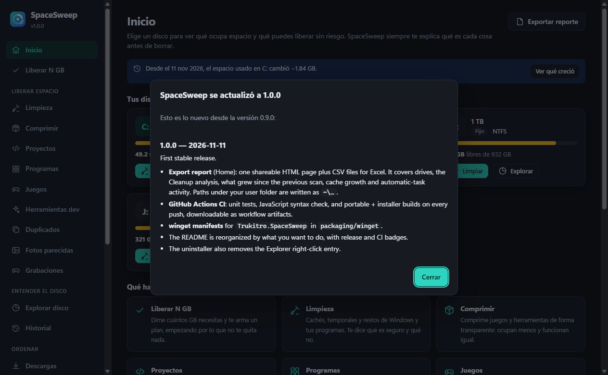
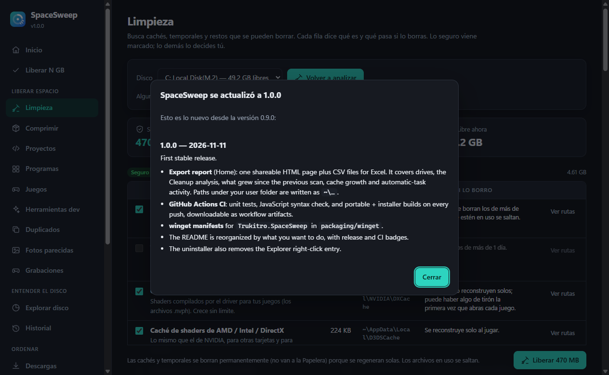
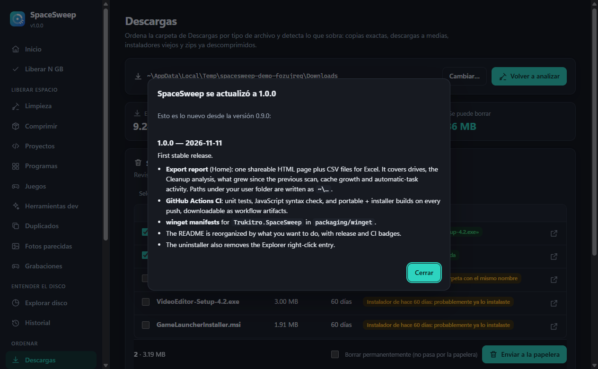
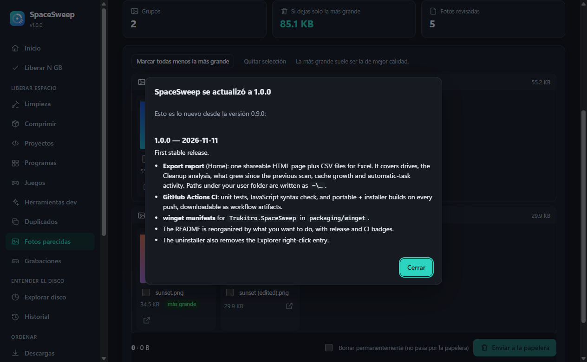

<p align="center">
  
</p>

<h1 align="center">SpaceSweep</h1>

<p align="center">Free up disk space on Windows without guessing what is safe to delete.</p>

<p align="center">
  <a href="https://github.com/Trukitro/SpaceSweep/releases/latest"></a>
  <a href="https://github.com/Trukitro/SpaceSweep/actions/workflows/ci.yml"></a>
  <a href="LICENSE"></a>
</p>

SpaceSweep finds caches, leftovers, duplicates, forgotten games and big files, and tells you in plain language **what each thing is, what happens if you delete it, and what you should never touch**. It focuses on the Windows system drive (C:) but works on any drive or folder, in Spanish or English.

It's a small native window (pywebview + HTML/CSS/JS) on top of a pure-Python engine:
- **one dependency**;
- **no admin rights** for almost everything;
- **nothing deleted** without a confirmation that lists exactly what goes.

<p align="center">
  
  
  
  
</p>

---

## Features

### Free up space
- **Free N GB assistant**: tell it how much you need. It builds one plan from every source below, ordered from *nothing lost* to *needs reinstalling*.
- **Cleanup**: 25+ known space hogs in five groups:
  - *Safe to delete*: temp files, GPU shader caches, driver installers, Windows Update downloads, crash dumps, browser, Teams/Slack/Zoom and dev caches.
  - *Your call*: Recycle Bin, game shaders, emulator images, Spotify cache, Thunderbird search index.
  - *Managed in its app*: WSL/Docker disks, AI models, chat media.
  - *Change in Windows*: page file, hibernation file, restore points.
  - *Never touch*: `Windows\Installer`, `WinSxS`, `DriverStore`.

  Every item says what it is and what happens if you delete it.
- **Compress without deleting**: transparent NTFS compression (LZX/XPRESS, like CompactOS) for installed games and rarely-changing tools. It measures size on disk, estimates the saving first, and can be reverted.
- **Code projects**: `node_modules`, Python venvs, Rust `target`, .NET `bin/obj` and build caches of projects you haven't touched in months, each with the command that recreates it.
- **Programs**: size and install date of everything installed, plus repeated versions. It tells you which are leftovers and which must stay (Visual C++, .NET runtimes).
- **Games**: Steam, Epic, GOG, Ubisoft and Xbox, with size, drive and *last played*. Uninstall goes through the launcher.
- **Dev tools & AI**:
  - Docker prune and WSL sparse mode.
  - Old LM Studio engines, obsolete VS Code extensions, old JetBrains versions.
  - Every local AI model on its own.
- **Duplicates**: byte-for-byte identical files (size → edge hash → BLAKE2). You can delete them, check them against a backup that is never touched, or replace them with **hard links**.
- **Similar photos**: bursts, edits and resized copies. It uses a dHash computed on the thumbnails Windows already makes, so no image library is needed.
- **Recordings**: Xbox Game Bar, NVIDIA, OBS and Steam clips with size and age.
- **Smart Recycle Bin**: empties only what has been there longer than N days.
- **Restore points** and **WinSxS via DISM** (administrator).

### Understand the drive
- **Disk explorer**: a parallel scan of any drive or folder with instant drill-down, the largest files, space by type, and space that couldn't be read.
- **History**: compare two dates to see **what grew**, down to the most specific folder. It also charts used space and cache growth.
- **Export report**: a shareable HTML page plus CSV files for Excel. Paths under your user folder are written as `~\…`.

### Organize
- **Downloads**: exact copies, unfinished downloads, old installers, extracted zips; sort by type with **undo**.
- **My folders**: Documents, Pictures and Videos by type, biggest files, old big files and likely leftovers; photos by EXIF date with **undo**.
- **Move to another drive**: copy, verify and leave a junction, so programs keep the same path. Reversible with *Bring back*.

### Keep it clean
- **Automatic**: Windows scheduled tasks with no resident process and no admin rights:
  - a daily low-space notification;
  - a weekly safe cleanup, optionally including old Recycle Bin items;
  - Downloads rules.
- **Explorer right-click**: *Analyze with SpaceSweep* on folders and drives (optional).
- **What's new**: the changelog inside the app, a summary after each update, and an optional daily check for new versions.

---

## Install

Download from [Releases](https://github.com/Trukitro/SpaceSweep/releases/latest):

| File | What it is |
|---|---|
| `SpaceSweepSetup.exe` | Installer: per-user, no admin rights, Spanish/English, Start-menu and desktop shortcuts. Uninstalling also removes SpaceSweep's scheduled tasks and Explorer menu entry. |
| `SpaceSweep.exe` | Portable single file (about 11 MB). |

The files aren't code-signed: if SmartScreen warns you, click **More info** → **Run anyway**. They need the Microsoft Edge WebView2 runtime, which is built into Windows 11 and updated Windows 10.

### From source

```bash
git clone https://github.com/Trukitro/SpaceSweep.git
python -m pip install -e SpaceSweep
python -m spacesweep
```

`python -m spacesweep` then works from any folder. `SpaceSweep.pyw` starts it without a console window.

### Build

```powershell
.\build.ps1            # folder build in dist\SpaceSweep\ (fastest start-up)
.\build.ps1 -OneFile   # dist\SpaceSweep.exe
.\build.ps1 -Installer # dist\SpaceSweepSetup.exe (needs Inno Setup 6)
```

Builds run in an isolated `.build-venv`, so only `pywebview` ends up in the .exe and your global Python is never modified. `python tools/screenshots.py` regenerates the screenshots from the real window using demo data. CI (GitHub Actions) runs the tests and both builds on every push.

---

## Usage

```bash
spacesweep               # native window
spacesweep --browser     # same UI in your browser (also the fallback without WebView2)
spacesweep --open PATH   # open Disk explorer on PATH (used by the Explorer right-click entry)
spacesweep --check       # daily task: free-space alert + Downloads rules, then exit
spacesweep --clean-safe  # weekly task: clean the "Safe to delete" group, then exit
spacesweep --debug       # native window with developer tools
```

A few cleanups need administrator rights (Windows Update cache, system Temp, DISM, restore points): use *Restart as admin* in the sidebar. Settings, history and undo logs live in `%LOCALAPPDATA%\SpaceSweep`.

---

## Project structure

```
spacesweep/
  api.py          methods the UI calls (pywebview js_api / HTTP bridge)
  cleanup.py      cleanup catalogue: what each item is, its risk group, what happens if deleted
  scanner.py      parallel disk scan + drill-down tree        history.py     snapshots, "what grew", free-space log
  analyzer.py     personal-folder analysis                    organizer.py   Downloads / photos plans with undo
  duplicates.py   exact duplicates, backup mode, hard links   photos.py      similar photos (shell thumbnails + dHash)
  devprojects.py  regenerable folders in code projects        inventory.py   programs, games, dev tools, AI models
  compress.py     transparent NTFS compression                planner.py     "free N GB" plan
  mover.py        move to another drive behind a junction     recordings.py  game capture folders
  recyclebin.py   $I/$R parsing, empty-older-than             winmaint.py    DISM, restore points
  automation.py   scheduled tasks, notifications              shellmenu.py   Explorer right-click entry
  report.py       HTML/CSV report                             updates.py     release check + changelog
  fsutil.py       fast walking, safe deletion                 winapi.py      ctypes: drives, Recycle Bin, UAC
  jobs.py         background jobs with progress and cancel    server.py      --browser mode (localhost + token)
  imaging.py      PNG/ICO without Pillow                      CHANGELOG.md   shown on the What's new page
  ui/             index.html, app.css, app.js, i18n.js, logo.svg, pages/*.js
tests/            unit tests (temp folders only)       tools/   make_icon.py, screenshots.py
installer/        Inno Setup script                    packaging/winget/   winget manifests
```

Run the tests with `python -m unittest discover -v`.

---

## Design choices

- **One dependency (`pywebview`).**
  - Windows APIs go through `ctypes` (no pywin32): COM shell thumbnails, Recycle Bin, known folders, compressed sizes.
  - Hashing uses `hashlib.blake2b`; EXIF, PNG and ICO are handled in a few lines (no Pillow).
  - The UI has no framework, CDN or web fonts.
- **Explain, then act.** Anything SpaceSweep can't delete safely (WSL disks, chat media, `WinSxS`) is explained and linked to the right tool instead of being touched.
- **Safe by default.** Your own files go to the Recycle Bin unless you choose otherwise, files in use are skipped, protected folders are refused, and moves and organizing can be undone.
- **No raw MFT reading.** In pure Python it isn't faster than the parallel `os.scandir` walk, and it would need administrator rights on every scan.
- **Browser mode is locked down**: it listens on `127.0.0.1` only, checks the `Host` header, and requires a per-run token on every call.

---

## Changelog

See [spacesweep/CHANGELOG.md](spacesweep/CHANGELOG.md), or **What's new** inside the app.

## Creator

Created by EtchTechnologies ([Rikion](https://github.com/Trukitro)).

## License

MIT, see [LICENSE](LICENSE).
